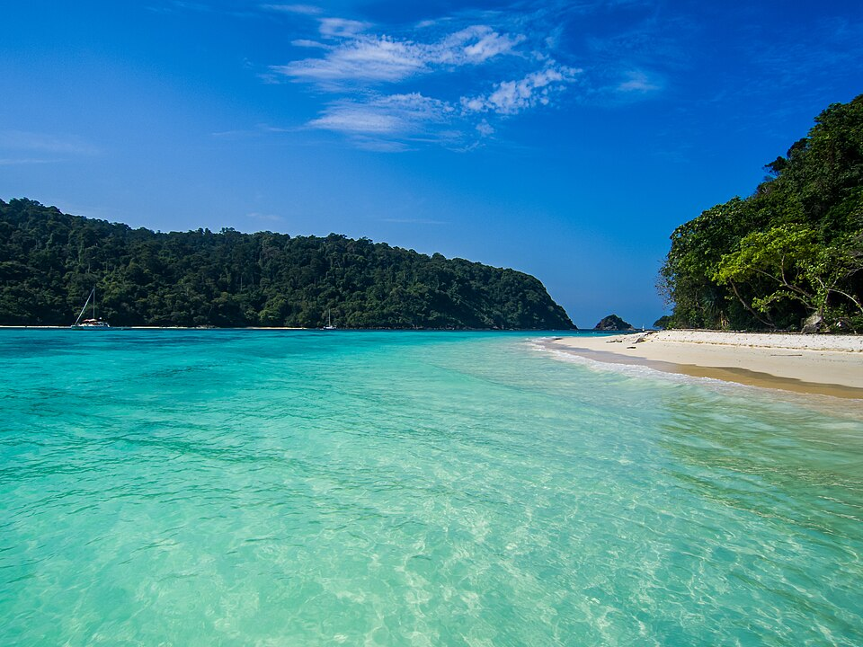
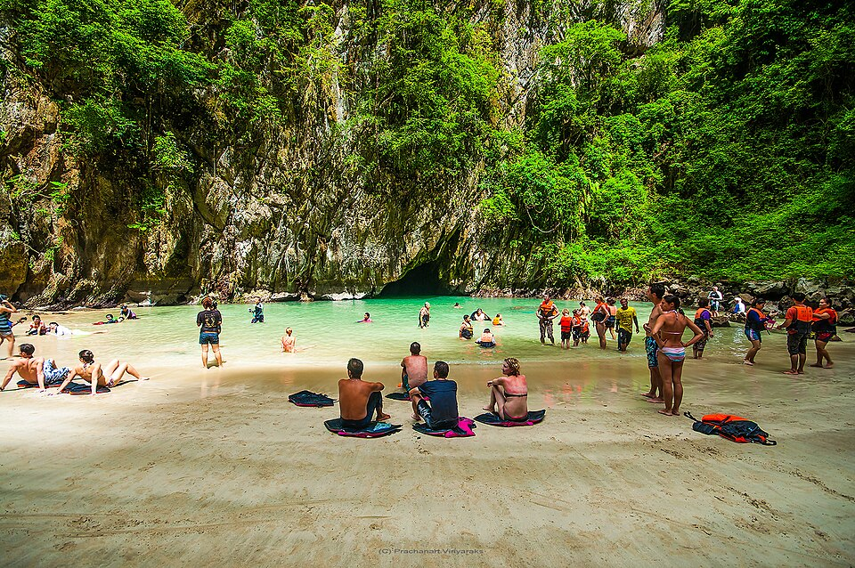
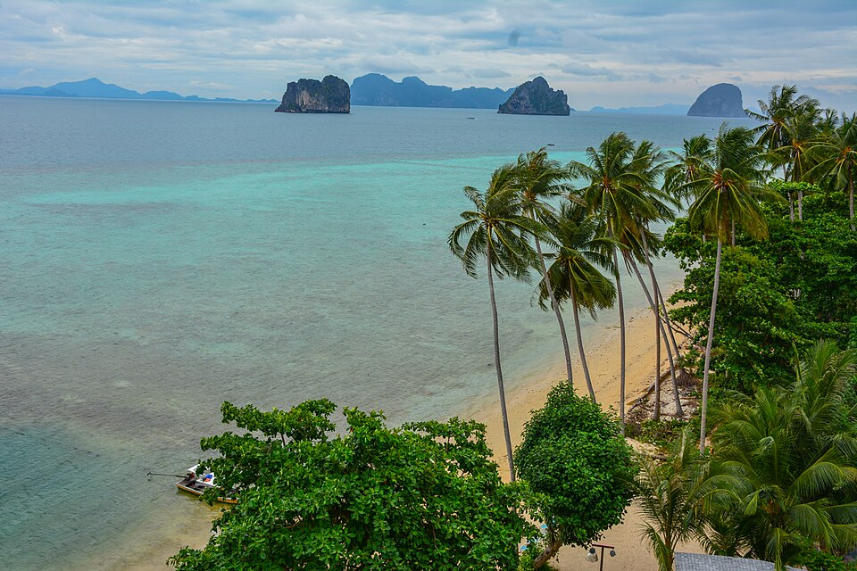

The two classic island trips from Koh Lanta are Koh Rok, for snorkelling, and the 4 Islands tour with the Emerald Cave. Both leave from Saladan and only run in high season, roughly November to April.

## Koh Rok and Koh Haa

*Photo: [dronepicr](https://commons.wikimedia.org/wiki/File:Beach_ko_rok_yai,_Thailand_-_Strand_(20133799361).jpg), [CC BY 2.0](https://creativecommons.org/licenses/by/2.0)*

Koh Rok is a pair of islands in Mu Ko Lanta National Park, about an hour south of Koh Lanta by speedboat. It's the classic snorkelling trip, and most tours add a second stop at Koh Haa.

A typical speedboat day trip picks you up at your hotel around 8:00, snorkels at Koh Rok in the morning, has lunch on the beach, stops at Koh Haa in the afternoon and gets you back around 16:00. As an example, [one operator](https://triplanta.com/tour/%E0%B8%97%E0%B8%B1%E0%B8%A7%E0%B8%A3%E0%B9%8C%E0%B9%80%E0%B8%81%E0%B8%B2%E0%B8%B0%E0%B8%95%E0%B8%B0%E0%B8%A5%E0%B8%B0%E0%B9%80%E0%B8%9A%E0%B9%87%E0%B8%87/) charges 1,800 THB per adult, including hotel transfer, lunch and snorkel gear.

## 4 Islands tour

*Photo: [Nik Cyclist](https://commons.wikimedia.org/wiki/File:Inside_the_emerald_cave_(8161381748).jpg), [CC BY 2.0](https://creativecommons.org/licenses/by/2.0)*

The 4 Islands tour hops between the islands south of Koh Lanta. The highlight is the Emerald Cave on Koh Mook, a sea cave you swim through to reach a hidden beach. Other stops are usually Koh Chueak, Koh Ngai and Koh Ma, with snorkelling and beach time in between.

*Photo: [Siamways](https://commons.wikimedia.org/wiki/File:Ko-Ngai-Thailand.jpg), [CC BY-SA 4.0](https://creativecommons.org/licenses/by-sa/4.0)*

By speedboat it's a full day, from about 8:00 to 16:00. [The same operator](https://triplanta.com/tour/%E0%B8%97%E0%B8%B1%E0%B8%A7%E0%B8%A3%E0%B9%8C-4-%E0%B9%80%E0%B8%81%E0%B8%B2%E0%B8%B0-%E0%B8%97%E0%B8%B0%E0%B9%80%E0%B8%A5%E0%B8%95%E0%B8%A3%E0%B8%B1%E0%B8%87-%E0%B9%80%E0%B8%81%E0%B8%B2%E0%B8%B0/) charges 1,500 THB per adult, with transfer, lunch and snorkel gear.

## National park fee

Koh Rok, Koh Ngai, Koh Haa and the Hin Daeng and Hin Muang dive sites are part of Mu Ko Lanta National Park. Foreign visitors pay 400 THB per adult and 200 THB per child to visit them, according to the [national park department's notice](https://thai.tourismthailand.org/Articles/%E0%B8%9B%E0%B8%A3%E0%B8%B0%E0%B8%81%E0%B8%B2%E0%B8%A8%E0%B8%81%E0%B8%A3%E0%B8%A1%E0%B8%AD%E0%B8%B8%E0%B8%97%E0%B8%A2%E0%B8%B2%E0%B8%99%E0%B8%AF%E0%B9%81%E0%B8%AB%E0%B8%A5%E0%B9%88%E0%B8%87%E0%B8%97%E0%B9%88%E0%B8%AD%E0%B8%87%E0%B9%80%E0%B8%97%E0%B8%B5%E0%B9%88%E0%B8%A2%E0%B8%A7%E0%B8%97%E0%B8%B5%E0%B9%88%E0%B8%95%E0%B9%89%E0%B8%AD%E0%B8%87%E0%B8%8A%E0%B8%B3%E0%B8%A3%E0%B8%B0%E0%B8%84%E0%B9%88%E0%B8%B2%E0%B8%9A%E0%B8%A3%E0%B8%B4%E0%B8%81%E0%B8%B2%E0%B8%A3%E0%B9%80%E0%B8%9B%E0%B9%87%E0%B8%99%E0%B8%9E%E0%B8%B4%E0%B9%80%E0%B8%A8%E0%B8%A9) (in Thai). Some tours include this fee and some don't, so ask before you book.

## Speedboat, longtail or private boat

Group speedboat tours are the fastest way to get out to Koh Rok, and usually the cheapest. Longtail boats are slower and louder, but you can hire one privately for your group and decide where to stop and for how long. Several private longtail operators, like Lanta Dream & Paradise, have excellent reviews on Google Maps.

Dive centers such as Phoenix Divers and Lanta Diver also take snorkellers out on their trips.

## When trips run

Island trips run in high season, roughly November to April. In rainy season the sea gets too rough, most trips stop, and the national park closes Koh Rok and Koh Haa every year. The dates change from year to year. See the [best time to visit Koh Lanta](/best-time-to-visit-koh-lanta/).

## How to book

You'll find tour agencies all over Saladan and along Long Beach, and many hotels can book a trip for you too. Before you pay, ask:

- Is the national park fee included?
- Speedboat or longtail, and how many people on the boat?
- Are hotel pick-up, lunch and snorkel gear included?

For more to do on the island itself, see [things to do](/activities/).
