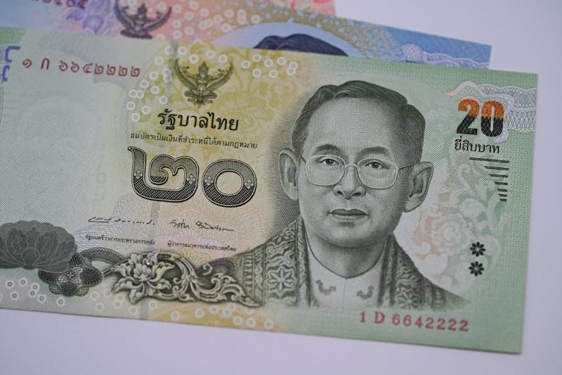

Cash is king on Koh Lanta, so you'll be using ATMs and money exchange booths a lot. For what things cost, see the [cost of living on Koh Lanta](/cost-of-living-koh-lanta/). Most local restaurants, massage shops, markets and small businesses only accept cash. Bigger restaurants, hotels and convenience stores like 7-Eleven take Visa and Mastercard, but don't count on it everywhere. Always have cash on hand.

*Photo by Q L on [Pexels](https://www.pexels.com/photo/close-up-of-thai-currency-featuring-20-baht-note-29917029/) (free to use)*

## ATMs

ATMs are scattered across the island, mostly at 7-Elevens and bank branches. You'll find them in Saladan, Klong Dao, Long Beach and Klong Nin. There are two banks in Saladan (SCB and TTB), and a Kasikorn ATM near Southern Lanta Resort at Klong Dao Beach.

Every withdrawal with a foreign card costs a fee: 250 THB on Visa, UnionPay and JCB, and **350 THB on Mastercard**. Those are the numbers in [Krungsri's fee schedule](https://www.krungsri.com/getmedia/00241a45-8959-4218-8d17-426f90ea9393/electronic-banking-service-fees-01092026-en) since 1 September 2026, and travel guides that checked Kasikorn and SCB found the same. You can't get around it, so take out as much as you can at once. If you have both a Visa and a Mastercard, use the Visa and you'll save 100 THB each time. The ATM shows the fee on screen before you confirm.

### Which ATM to use

Not all ATMs are equal. Krungsri (yellow) ATMs let you pull 30,000 THB per transaction, while most others cap at 20,000 THB. That difference matters when you're paying a flat fee every time.

| Bank | ATM Color | Max per withdrawal |
|------|-----------|-------------------|
| Krungsri | Yellow | 30,000 THB |
| Bangkok Bank | Blue | 25,000 THB |
| Kasikorn (KBank) | Green | 20,000-30,000 THB |
| SCB | Purple | 20,000 THB |
| Krungthai | Light blue | 20,000 THB |

**Look for the yellow Krungsri ATMs.** On a 30,000 THB withdrawal, the 250 THB Visa fee works out to about 0.8%. At a machine that stops at 20,000 THB it's 1.25%. With a Mastercard, those become 1.2% and 1.75%.

Use the [Krungsri location finder](https://www.krungsri.com/en/locations) to find one nearby: select **ATM** and enter postal code **81150**.

The chance of an ATM on Koh Lanta skimming your card is very, very low, but not zero. So try to use the same ATM every time you need money.

### Decline the currency conversion

Important when using any ATM

<ul>
<li>The ATM will ask if you want to convert to your home currency. <strong>Always say no.</strong></li>
<li>This is called Dynamic Currency Conversion (DCC) and the markup is typically 3-5% worse than your bank's own rate.</li>
<li>Choose "withdraw without conversion" or "charge in THB" and let your card issuer handle the conversion.</li>
</ul>

## Cards for travel

If you're staying for a while, a [Wise card](https://wise.com/invite/ath/jacobusd57) is worth getting before your trip. It converts at the mid-market exchange rate with a small fee (around 0.4-0.6%) and has no foreign transaction fee on card payments. ATM withdrawals are free up to a monthly allowance that depends on where your card was issued. For EEA cards that's 250 EUR a month since May 2026, with 2.69% on anything above it. The app shows your allowance under ATM fees. You still pay the Thai ATM fee on top.

Your home bank debit or credit card will also work at ATMs and larger shops, but check what foreign transaction fees they charge. Many banks add 1-3% on top of the exchange rate, which adds up over a month.

## Mobile payments

**PromptPay** is Thailand's QR payment system. You'll see QR codes at many shops and restaurants, but you need a Thai bank account to use it directly.

**TrueMoney Wallet** is more accessible for foreigners. You can sign up with your passport and a Thai SIM card, then top up at 7-Eleven (max 3,000 THB per top-up). With just your passport the wallet holds up to 30,000 THB, or 50,000 THB once you add a supporting document. It works at shops displaying TrueMoney QR codes.

That said, most short-stay visitors just stick with cash and cards. Mobile payments are a nice bonus if you're here for a few months.

## Currency exchange

There are exchange booths around Saladan and in tourist areas along the beaches. Rates are okay but not great compared to Bangkok. SCB in Saladan has an exchange window that's accessible outside banking hours.

If you're flying through Bangkok, exchanging some cash at a SuperRich counter at Suvarnabhumi Airport will get you a better rate than anything on the island. There is no SuperRich in Krabi or on Koh Lanta.

For the best overall rate, use a [Wise card](https://wise.com/invite/ath/jacobusd57) for purchases and withdraw cash from Krungsri ATMs when you need it.

## Tipping

Tipping is not required in Thailand, but it's appreciated in tourist areas. Some rough guidelines:

- **Restaurants:** Check if a 10% service charge is on the bill. If not, leaving 5-10% for good service is a nice gesture. At local Thai restaurants and street food stalls, tipping is uncommon. Rounding up or leaving the coins is fine.
- **Massage:** 50-100 THB for a standard Thai massage. 100-200 THB for longer spa treatments. Hand it directly to the therapist.
- **Taxis:** Not expected. Rounding up the fare by 10-20 THB is enough.
- **Hotel staff:** 20-50 THB for porters or housekeeping if you feel like it.

<!--
## Opening a Thai bank account

This is only relevant if you're on a long-term visa (work permit, retirement, or education visa). Tourist visa holders, visa-exempt visitors, and DTV holders can no longer open accounts at major banks - despite the DTV being a long-stay visa, banks classify it as a tourist category.

If you qualify, **Bangkok Bank** is generally the most foreigner-friendly. You'll need your passport, proof of a Thai address (a Certificate of Residence from immigration works best), and a Thai phone number. The minimum opening deposit is 500 THB.

Having a Thai account gives you access to PromptPay, mobile banking, and much cheaper transfers.
-->
