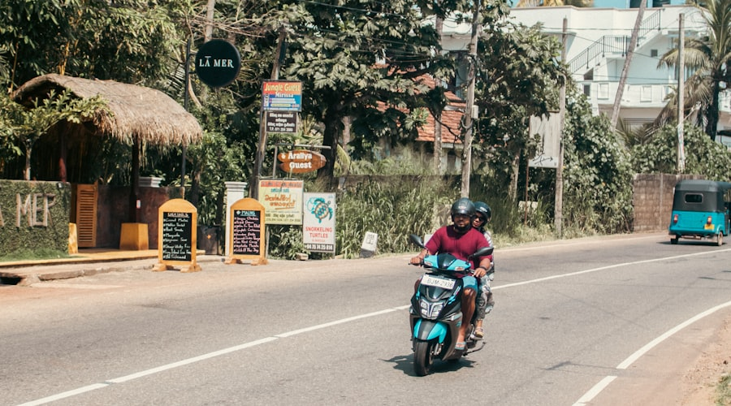
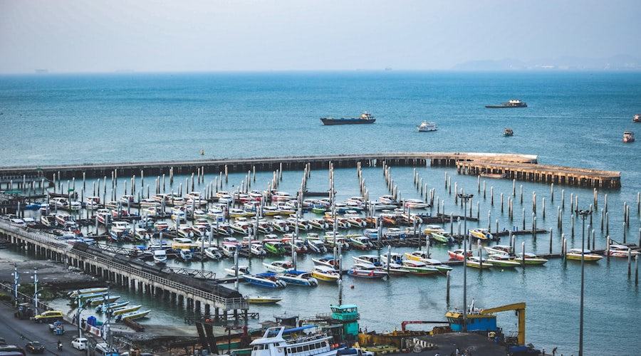
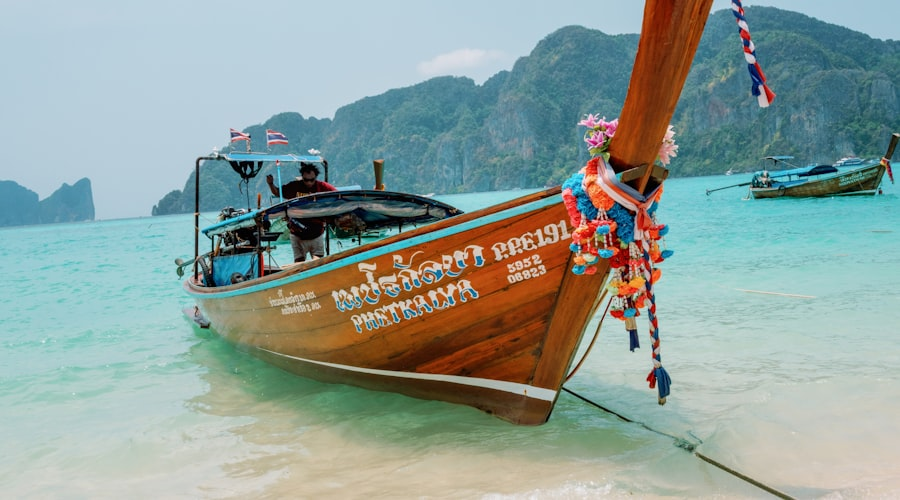

There's no public transport on Koh Lanta. Most people rent a scooter and that's pretty much all you need. The island is about 30km from north to south, so even the longest trip only takes around 40 minutes.

## Getting to the island

Most people fly into Krabi and take a shared minivan or private transfer to Koh Lanta, about 2 to 2.5 hours including the car ferry. See [Krabi Airport to Koh Lanta](/krabi-airport-to-koh-lanta/) for prices and transfer companies, or [getting to Koh Lanta](/getting-here/) for all routes.

## Scooter rental

This is how most people get around. You'll see rental shops all over the island, especially along the main road in <a href="https://www.google.com/maps/search/?api=1&query=Saladan+Koh+Lanta" target="_blank" rel="noopener">Saladan</a> and near the popular beaches.

<ul class="price-list">
  <li>Daily 250-300 THB</li>
  <li>Weekly Ask the shop</li>
  <li>Monthly 3,000-5,000 THB</li>
</ul>

The price depends on the season, the bike's condition, and how long you're renting. Always check the brakes, tires, and lights before you ride off. Take photos of any existing scratches so you don't get blamed for them later.

<a href="https://maps.app.goo.gl/HbMNqjybkxesGZ9t6" target="_blank" rel="noopener">Nare Scooter Rental Shop</a> has nicer, newer bikes than most places on the island. Worth paying a bit extra for a well-maintained scooter.

### Driving tips

Good to know before you ride

<ul>
<li>An international driving permit (IDP) is technically required. Police do occasional checkpoints and the fine is 500 THB without one.</li>
<li>Wear a helmet. It's the law, and the roads get steep and winding in the southern part of the island.</li>
<li>Roads are in acceptable shape, watch out for sand, gravel. Never drive through puddles of water.</li>
<li>Riding at night without a visor? Keep bugs and sand out of your eyes. <a href="https://maps.app.goo.gl/33JTgZ7otL8R2VvH8" target="_blank" rel="noopener">Modern Optic Lanta</a> sells clear (non-tinted) glasses made for night riding.</li>
</ul>

### Don't want to drive?

If you don't have a license or you're not comfortable on a scooter, <a href="https://maps.app.goo.gl/uipWxpP8qxHMzeKG8" target="_blank" rel="noopener">Koh Lanta Bike Rentals</a> rents e-bikes. Good for shorter trips around your area.

### Flat tires

When you inevitably get a flat, head to this <a href="https://maps.app.goo.gl/cSukRtbw65ANbrgo6" target="_blank" rel="noopener">tire repair shop</a>. Fixes are quick and cheap (around 50-100 THB). For a broken phone or laptop, see [phone and laptop repair](/repairs/).

## Taxis on the island

[There's no Grab on Koh Lanta](/grab/), so you call or message a taxi driver directly. Taxis are handy when you have a lot of luggage or need to get somewhere late at night.

Expect to pay 200-500 THB depending on distance. Agree on the price before you get in.

  

    <strong>Mr. Jook</strong>
    <a href="https://wa.me/66869432382" target="_blank" rel="noopener">+66 86 943 2382</a>
    WhatsApp
  

  

    <strong>Taxi Nana Lanta</strong>
    <a href="https://wa.me/66973528409" target="_blank" rel="noopener">+66 97 352 8409</a>
    WhatsApp
  

  

    <strong>Aek Taxi &amp; Laundry</strong>
    <a href="https://wa.me/66828080111" target="_blank" rel="noopener">+66 82 808 0111</a>
    WhatsApp — friendly, reliable, and can pick up and drop off your laundry (via <a href="https://maps.app.goo.gl/JZ43JGih47bJHyjn7" target="_blank" rel="noopener">Alita Laundry Services</a>) along the way
  

Tuk-tuks and songthaew (shared pickup trucks) are sometimes available near Saladan and the main beaches, but they're not something you can count on. Prices tend to be inflated compared to a direct taxi.

## Ferries

During high season (November to April), ferries run daily from <a href="https://www.google.com/maps/search/?api=1&query=Saladan+Pier+Koh+Lanta" target="_blank" rel="noopener">Saladan Pier</a> to nearby islands. In low season, most routes shut down.

| Destination | Travel time | Approx. price |
|---|---|---|
| Koh Phi Phi | 30 min - 1 hr | 400-500 THB |
| Phuket | 1.5 - 2 hrs | 600-1,200 THB |
| Krabi (Klong Jilad Pier) | 1 hr | 400-500 THB |
| Ao Nang / Railay | 1 - 1.5 hrs | 400-600 THB |
| Koh Ngai | 30 min | 400 THB |
| Koh Lipe | 3 hrs | 1,200-1,700 THB |

Ferry operators include Chaokoh Ferry, Bundhaya Speed Boat, Tiger Line Ferry, and Andaman Wave Master. You can book tickets at travel agencies in Saladan or online through <a href="https://www.ferryhopper.com/en/ferries/thailand/koh-lanta" target="_blank" rel="noopener">Ferryhopper</a> or 12Go Asia.

Book a few days ahead during peak season (December/January), as popular routes sell out.

## Day trips by boat

Longtail boats can be hired for day trips to the nearby islands (Koh Rok, four islands tour, etc.). You'll find tour operators all over Saladan and along Long Beach. See the [trips page](/trips/) for more details.
